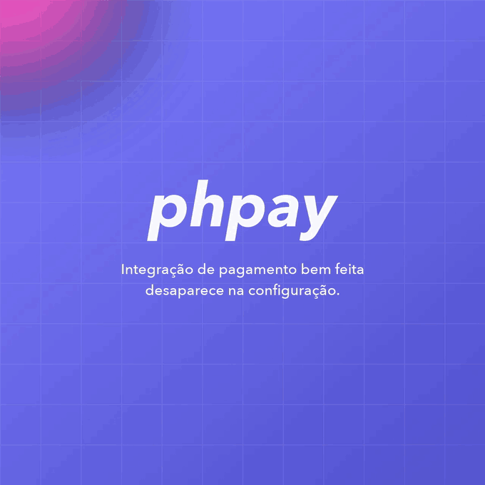

# PHPay para Laravel

Bridge do [PHPay](https://github.com/phpay-io/phpay) para Laravel: o gateway vem
da configuração, e o webhook chega como evento.

> **Em construção.** A v0.1 ainda não foi publicada no Packagist.

<p align="center">
    
</p>

## Por que um pacote separado

O `composer.json` do PHPay não tem dependência de framework, e isso é
deliberado: um bridge dentro do core forçaria Laravel em todo mundo que instala
a biblioteca. Então ele mora aqui.

## Instalação

```bash
composer require phpay-io/phpay-laravel
php artisan vendor:publish --tag=phpay-config
```

Requisitos: PHP `^8.2` e **Laravel 12**.

> **Por que só o Laravel 12.** Toda release do 10 e do 11 está sob advisory de
> segurança, e o Composer as bloqueia por padrão — declarar suporte a elas seria
> prometer o que ninguém consegue instalar. E o 12 exige PHP `^8.2`, que é de
> onde vem o piso daqui: o core aceita `^8.1`, mas neste pacote o Laravel manda.

## O gateway vem da config

```php
use PHPay\Laravel\Facades\Phpay;

Phpay::charge()->setCharge($dados)->create();        // o gateway de `default`
Phpay::gateway('woovi')->charge()->create(10050);    // outro, nomeado
```

```php
// config/phpay.php
'default'  => env('PHPAY_GATEWAY', 'asaas'),
'gateways' => [
    'asaas' => ['token' => env('ASAAS_TOKEN'), 'sandbox' => env('ASAAS_SANDBOX', true)],
],
```

Quem usa um gateway só pode injetar a classe do core direto, sem ver o manager:

```php
public function __construct(private PHPay $phpay) {}
```

As chaves de cada gateway são as que ele exige, e **elas não coincidem**: seis
pedem uma credencial, quatro pedem duas, e Mercado Pago, Pagar.me e AbacatePay
**não aceitam `sandbox`** — o ambiente deles vem do prefixo da credencial.
Mandar a chave ali levanta exceção em vez de ser ignorada. O config publicado
traz os dez comentados.

### Certificado: o Inter entrega em dois arquivos

Efí e Inter falam **mTLS**, e não entregam o certificado do mesmo jeito. A Efí
manda um `.p12` com certificado e chave dentro; o Inter manda um `.crt` e um
`.key` separados. Os dois casos são configuração:

```php
'efi' => [
    'certificate' => env('EFI_CERTIFICATE'),              // caminho do .p12
    'passphrase'  => env('EFI_CERTIFICATE_PASSPHRASE'),   // se a chave é cifrada
],

'inter' => [
    'certificate' => env('INTER_CERTIFICATE'),            // caminho do .crt
    'privateKey'  => env('INTER_PRIVATE_KEY'),            // caminho do .key
    'passphrase'  => env('INTER_CERTIFICATE_PASSPHRASE'),
],
```

A documentação do Inter manda juntar os dois com `openssl pkcs12 -export` antes
de usar. **Não precisa** — o cURL aceita as metades como vêm. Se você já
converteu, preencha só `certificate` com o caminho do `.p12`.

O objeto `Certificate` é montado no `GatewayManager`, não no arquivo de config,
e isso é por necessidade e não por gosto: o `config:cache` serializa a config
com `var_export`, e um objeto sem `__set_state()` sai como código que não
carrega; e o construtor levanta quando o arquivo não é legível, o que dentro da
config seria **todo** comando do artisan. Montando na resolução do gateway, um
caminho errado falha onde dá para ver.

Preencher a chave privada sem o certificado levanta `GatewayNotConfigured` com
essa mensagem, em vez de virar "este gateway precisa de certificado" mais tarde.

### O token do Inter é emitido por escopo

`scope` é obrigatório na requisição do token, e não existe token que carregue
todas as permissões. Vazio na config, o pacote pede a união do que as
capacidades do gateway usam — que é o que a maioria quer:

```php
'inter' => ['scopes' => env('INTER_SCOPES')],
```

Preencha só se a sua aplicação tem permissão mais estreita: pedir escopo que ela
não tem reprova a requisição inteira. E **gerar token é limitado a 5 chamadas por
minuto**, então o gateway guarda o que recebeu pela hora de validade — o manager
reaproveita a instância dentro da requisição justamente para não jogar isso fora.

Para ver o que está configurado e o que cada um faz:

```bash
php artisan phpay:gateways
```

## O webhook chega como evento

Com `webhooks.route` preenchida, o pacote registra uma rota que verifica a
assinatura, lê a notificação e despacha um `WebhookEventReceived` **por evento
lido**:

```php
use PHPay\Laravel\Events\WebhookEventReceived;
use PHPay\Webhooks\EventType;

class LiberarPedido
{
    public function handle(WebhookEventReceived $received): void
    {
        match ($received->event->type) {
            EventType::PAID     => $this->liberar($received->event->resourceId),
            EventType::REFUNDED => $this->estornar($received->event->resourceId),
            default             => null,
        };
    }
}
```

**Por evento lido, não por requisição.** Uma notificação pode trazer vários: a
API Pix da Efí manda um array de pagamentos recebidos, e o PagBank manda o
pedido com todas as cobranças.

O `Event` é `readonly` e serializa, então listener em fila funciona.

### Quando a notificação não diz o estado

Quatro gateways notificam que algo mudou e nada mais. O
`requiresLookup()` diz quando é preciso consultar de volta:

```php
if ($received->event->requiresLookup()) {
    $cobranca = Phpay::gateway($received->gateway)->charge()->find($received->event->resourceId);
}
```

### O gateway que não assina é recusado, não aceito em silêncio

Cinco dos dez não assinam a notificação. Registrar a rota e aceitar seria o
caminho para confirmação de pagamento forjada por quem descobrir a URL, então a
rota responde `501` — a menos que a config declare que você confere de outra
forma:

```php
'cielo' => ['unverified' => true],
```

| | assina | é lido |
| --- | :---: | :---: |
| Asaas, Woovi, Mercado Pago, PagBank | ✅ | ✅ |
| Efí, Inter, Pagar.me, Cielo | — | ✅ |
| AbacatePay | ✅ | — |
| Rede | — | — |


Deixe `webhooks.route` como `null` para cuidar disso no seu próprio controller,
o que é a escolha certa quando a notificação tem que fazer mais que despachar
eventos.

## Testando a sua aplicação

```php
use PHPay\Laravel\Facades\Phpay;

Phpay::fake([new Response(200, [], json_encode(['id' => 'pay_001']))]);

$pedido->pagar();

Phpay::assertSent(fn (RequestInterface $r) => $r->getMethod() === 'POST');
Phpay::assertSentCount(1);
Phpay::assertNothingSent();
```

Fino sobre o `ClientFactory::fake()` do core, que falseia **todos** os clients
da biblioteca — inclusive os segundos que Efí, Cielo e Rede mantêm para outro
host. O que o bridge acrescenta é descartar o cache de gateway resolvido: um
gateway construído antes do `fake()` carrega client real, e sem isso a primeira
chamada do teste iria para a rede.

A mensagem de falha diz o que **foi** enviado, com método e URI:

```
Esperava nenhuma requisição. Foram enviadas 1:
  GET https://sandbox.asaas.com/api/v3/payments/pay_001
```

**Desligue no teardown.** É estado estático no core, com o contrato do
`Mail::fake()`:

```php
afterEach(fn () => Phpay::stopFaking());
```

## Uma pegadinha de nome

A facade se chama **`Phpay`**, não `PHPay`. Nomes de classe em PHP são
insensíveis a caixa, então `PHPay\Laravel\Facades\PHPay` e o `PHPay\PHPay`
do core seriam **o mesmo nome**.

A consequência prática: num arquivo que importa a facade, você não pode
escrever um nome totalmente qualificado começando em `PHPay\` — ele resolve
sob o alias. Importe a classe:

```php
use PHPay\Asaas\Resources\Charge\Charge as AsaasCharge;   // ✅
// $x instanceof PHPay\Asaas\Resources\Charge\Charge      // ❌ resolve errado
```

## Desenvolvimento

```bash
composer install
composer test        # pint + pest + phpstan
```

A suíte usa [Testbench](https://github.com/orchestral/testbench) e **não acessa
a rede**: os gateways não fazem requisição ao serem construídos.

## Licença

[Business Source License 1.1](./LICENSE.md), a mesma do PHPay.
